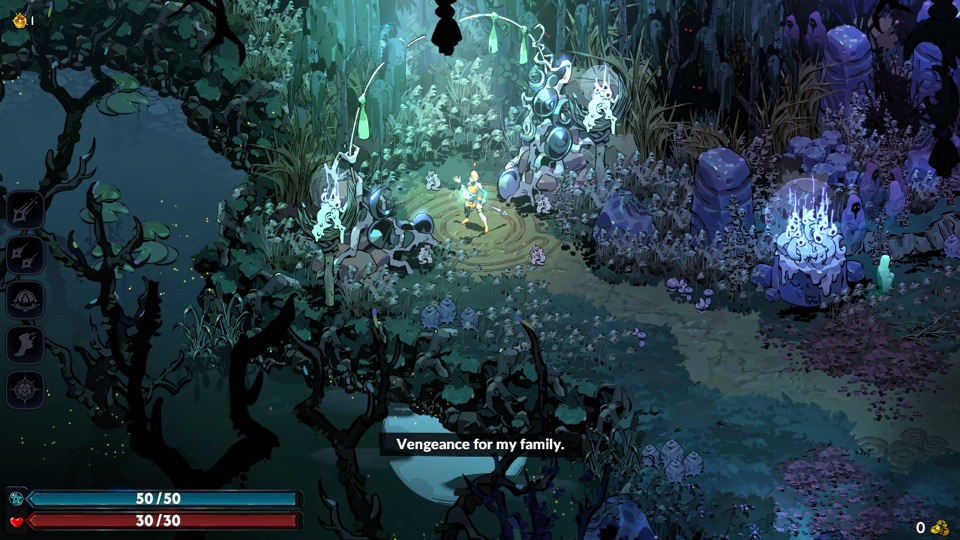
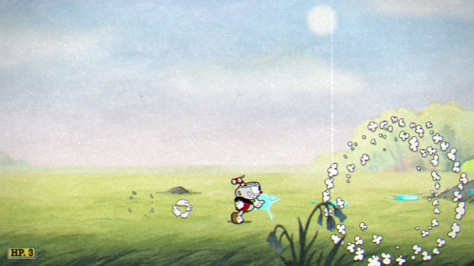
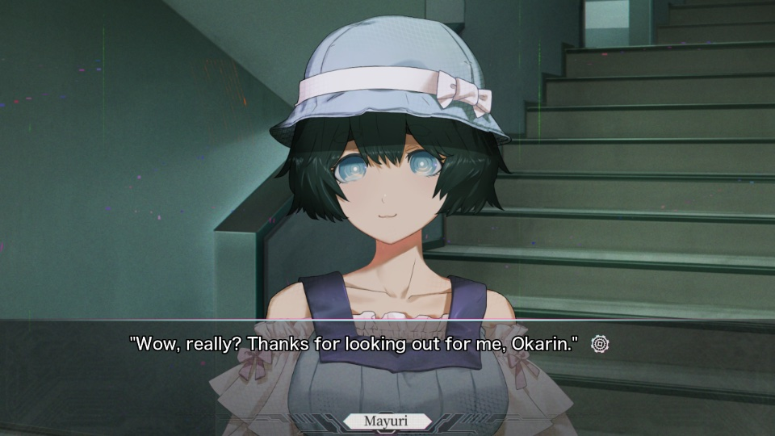
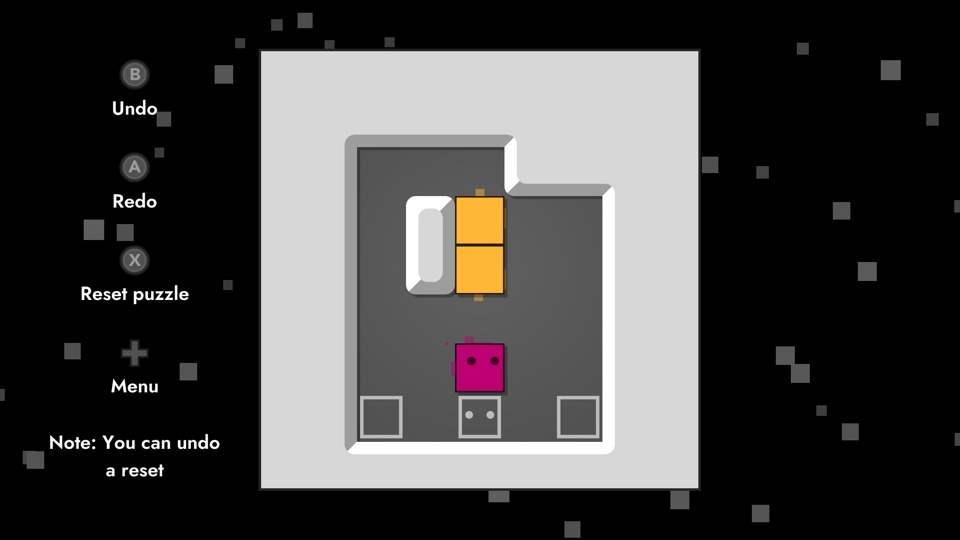
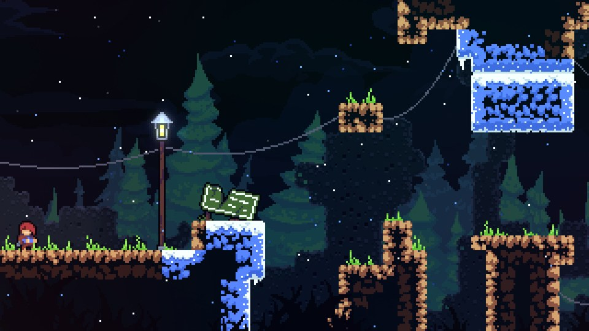
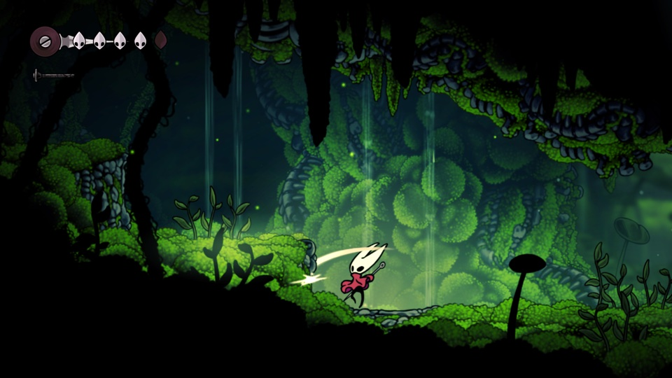
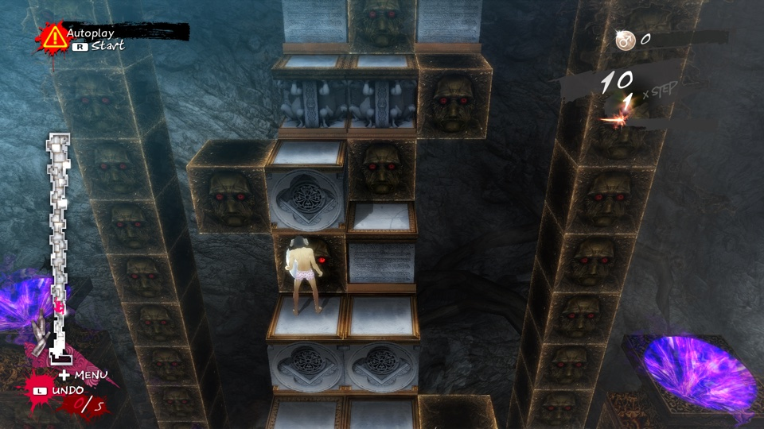
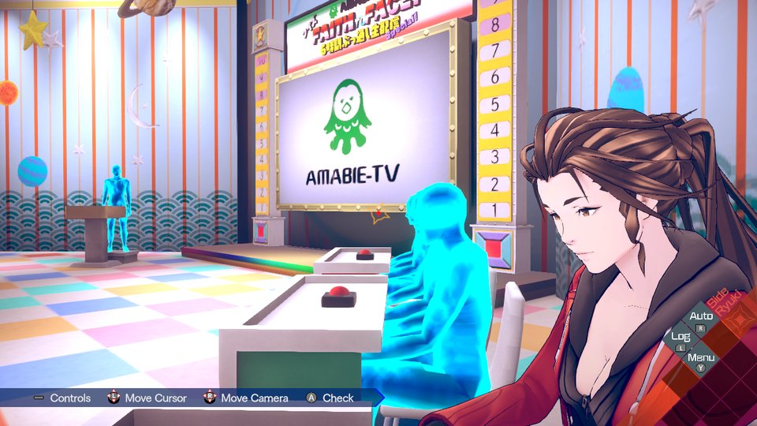

# nxnative

Play your own Nintendo Switch games natively on iPhone and iPad. Bring your game (its NSP files) and your `prod.keys`; one script turns them into an IPA that you sideload.

It is not an emulator: the game's own code runs directly on the Apple chip, with Switch graphics rebuilt on Metal. Nothing from any game is in this repository, and the project is not affiliated with Nintendo or any game publisher.

## Acknowledgements

This project is built on other people's work:

- **[d2r-mobile](https://github.com/jhaizhou-ops/d2r-mobile)** (MIT) developed this native-execution approach, for Diablo II: Resurrected. nxnative started as a copy of its generic parts: the NSO rewriter, the host that stands in for Horizon, the NVN-on-Metal layer and the iOS app shell. Fixes go both ways.
- **Ryujinx** (MIT): its shader translator (`Ryujinx.Graphics.Shader`, `Ryujinx.Common` and `Spv.Generator` 1.3.2, in `dm/third_party/ryujinx` with a few fixes listed in [its README](dm/third_party/ryujinx/README.md)) turns the games' Maxwell shaders into SPIR-V. Its emulation of the kernel and system services is also a reference when the host's behaviour is in doubt.
- **[Atmosphère](https://github.com/Atmosphere-NX/Atmosphere)**: its kernel, mesosphère, is the reference for Horizon's synchronization semantics (address arbiter, condition variables).
- **yuzu**: Maxwell instruction encodings for the shader reference tool, and a cross-check for kernel behaviour.
- **[LibHac](https://github.com/Thealexbarney/LibHac)**: reads NSPs and layers updates over the base game in `dm/tools/nx_extract`. **hactool** did the first extractions.
- **[SPIRV-Cross](https://github.com/KhronosGroup/SPIRV-Cross)**: SPIR-V to Metal Shading Language. **[glslang](https://github.com/KhronosGroup/glslang)** compiles the GLSL of OpenGL games to SPIR-V for it.
- **deko3d** (zlib): its texture layout size algorithm is ported in `dm/gfx/nvn/nvn_tex.c`.
- **libvpx** (VP9 movies), **stb_vorbis** (movie sound), the **Vulkan headers** and **NVIDIA FLIP** ship in `dm/third_party` with their licenses ([list](dm/third_party/README.md)).
- **Capstone**, **lz4**, **fontTools** and **XcodeGen** are used by the build.

## Games

The upstream project reports the following games as tested on an iPhone and playable:

The tested path needs iOS / iPadOS 26 or later on an iPhone 15 Pro or newer (A17 Pro chip or later) or an iPad with an M1 chip or later: the games' textures are BC-compressed, and older iPhones can't read that format. Other games aren't supported yet. For them the script writes a survey and still tries its best to pack an IPA, guessing the game's settings; such an IPA may not start.

This branch also retains an experimental iOS 17 / Metal 3 compatibility path. It has not been validated on an iOS 17 device; the upstream game results above do not establish compatibility with that path.

| | |
|:---:|:---:|
| <br>Super Mario Bros. Wonder<br><sub>IPA ~4 GB</sub> | <br>Fire Emblem Engage<br><sub>IPA ~15 GB · 60 fps (30 on Switch) with update 2.0.0</sub> |
| <br>Metroid Dread<br><sub>IPA ~5 GB</sub> | <br>13 Sentinels: Aegis Rim<br><sub>IPA ~5 GB</sub> |
| <br>Super Mario 3D World + Bowser's Fury<br><sub>IPA ~3 GB</sub> | <br>The Legend of Zelda: Breath of the Wild<br><sub>IPA ~16 GB · 60 fps (30 on Switch) with update 1.9.0</sub> |
| <br>The Legend of Zelda: Link's Awakening<br><sub>IPA ~6 GB</sub> | <br>Super Mario Odyssey<br><sub>IPA ~6 GB</sub> |
| <br>Hades<br><sub>IPA ~4 GB</sub> | <br>Hyrule Warriors: Age of Calamity<br><sub>IPA ~15 GB · 60 fps (30 on Switch) with update 1.3.0</sub> |
| <br>Fire Emblem: Three Houses<br><sub>IPA ~13 GB · 60 fps (30 on Switch) with update 1.2.0</sub> | <br>Super Mario Galaxy<br><sub>IPA ~3 GB</sub> |
| <br>The Legend of Zelda: Tears of the Kingdom<br><sub>IPA ~17 GB · 60 fps (30 on Switch) with update 1.4.3</sub> | <br>Monster Hunter Rise<br><sub>IPA ~22 GB · 60 fps (30 on Switch) with update 16.0.2</sub> |
| <br>Ace Attorney Investigations Collection<br><sub>IPA ~7 GB</sub> | <br>Hades II<br><sub>IPA ~4 GB</sub> |
| <br>Unicorn Overlord<br><sub>IPA ~4 GB</sub> | <br>Rhythm Heaven Groove<br><sub>IPA ~3 GB</sub> |
| <br>Octopath Traveler 0<br><sub>IPA ~4 GB · 60 fps (30 on Switch) with update 1.0.5</sub> | <br>Pokémon Legends: Z-A<br><sub>IPA ~6 GB</sub> |
| <br>Cuphead<br><sub>IPA ~5 GB</sub> | <br>Super Mario Galaxy 2<br><sub>IPA ~3 GB</sub> |
| <br>FINAL FANTASY TACTICS - The Ivalice Chronicles<br><sub>IPA ~11 GB</sub> | <br>Absolum<br><sub>IPA ~2 GB</sub> |
| <br>Captain Toad: Treasure Tracker<br><sub>IPA ~2 GB</sub> | <br>Brain Memory Training Academy<br><sub>IPA ~0.1 GB</sub> |
| <br>The Great Ace Attorney Chronicles<br><sub>IPA ~4 GB</sub> | <br>STEINS;GATE RE:BOOT<br><sub>IPA ~6 GB</sub> |
| <br>Big Brain Academy: Brain vs. Brain<br><sub>IPA ~0.8 GB</sub> | <br>Patrick's Parabox<br><sub>IPA ~0.2 GB</sub> |
| <br>Celeste<br><sub>IPA ~0.9 GB</sub> | <br>DRAGON QUEST XI S: Echoes of an Elusive Age – Definitive Edition<br><sub>IPA ~15 GB · 60 fps (30 on Switch) with update 1.0.4</sub> |
| <br>Monster Train 2<br><sub>IPA ~1.6 GB · 60 fps (30 on Switch) with update 1.1.1</sub> | <br>Raging Loop<br><sub>IPA ~0.9 GB</sub> |
| <br>DARK SOULS: REMASTERED<br><sub>IPA ~4 GB · 60 fps (30 on Switch) with update 1.0.3</sub> | <br>Paper Mario: The Thousand-Year Door<br><sub>IPA ~5 GB · 60 fps (30 on Switch) with update 1.0.1</sub> |
| <br>Hollow Knight: Silksong<br><sub>IPA ~6.4 GB</sub> | <br>Catherine: Full Body<br><sub>IPA ~14 GB</sub> |
| <br>Digimon Story Cyber Sleuth: Complete Edition<br><sub>IPA ~5 GB</sub> | <br>Animal Crossing: New Horizons<br><sub>IPA ~10.5 GB with update 3.0.3</sub> |
| <br>DRAGON QUEST VII Reimagined<br><sub>IPA ~5.9 GB with update 1.2.0</sub> | <br>FINAL FANTASY RESONANCE<br><sub>IPA ~10 GB · 60 fps (30 on Switch) with update 1.0.1</sub> |
| <br>Luigi's Mansion 3<br><sub>IPA ~7.5 GB · 60 fps (30 on Switch) with update 1.4.0</sub> | <br>AI: THE SOMNIUM FILES<br><sub>IPA ~8.3 GB</sub> |
| <br>ANIMAL WELL<br><sub>IPA ~54 MB · update 1.0.10</sub> | <br>AI: THE SOMNIUM FILES - nirvanA Initiative<br><sub>IPA ~11.6 GB · update 1.0.2</sub> |
| <br>Mario Kart 8 Deluxe<br><sub>IPA ~11.9 GB · update 4.0.0 · Mii heads not drawn (no firmware)</sub> | |

## Pack an IPA

**1. Get nxnative and its tools** (once, on a Mac with [Xcode 26 or later](https://apps.apple.com/app/xcode/id497799835) and [Homebrew](https://brew.sh)):

```
git clone https://github.com/seedds/nxnative.git && cd nxnative
brew install xcodegen zstd spirv-cross glslang
brew install --cask dotnet-sdk
python3 -m pip install lz4 capstone fonttools "backports.zstd; python_version < '3.14'"
```

**2. Put one game's NSPs in a folder**: the base game (an NSP, or an XCI cartridge dump), plus its update and DLC if you have them:

```
~/Games/MarioWonder/
  Super Mario Bros. Wonder [010015100B514000][v0].nsp
  Super Mario Bros. Wonder [010015100B514800][v327680].nsp
```

Any version works, with or without an update: the script packs the newest version in the folder. DLC is optional too: the DLC in the folder is packed, and without it the game sees none, as on a Switch without it. Each game was tested on one version (an update named in the table above is the one its 60 fps needs). With another version the script builds the game with that version's own shaders and says that the version was not tested; fixes made for the tested version's code, such as the 60 fps ones, don't apply to it.

**3. Run the script:**

```
python3 scripts/build_ipa_from_nsp.py ~/Games/MarioWonder -k ~/keys/prod.keys
```

The IPA appears in the same folder (here `~/Games/MarioWonder/SMBWMobile.ipa`). The first build takes 30–60 minutes, later ones about 10. You need free disk space of about twice the NSPs' size plus 10 GB. Options such as `-o` (output path) and `--app-name` are listed by `-h`.

**4. Install** the IPA with your sideloading tool (AltStore, Sideloadly, LiveContainer, …). The app gets the game's name, icon and version (the update's version, for example 1.2.1 for Mario Wonder; the base game's when there is no update). Sign it with the **Increased Memory Limit** capability (`com.apple.developer.kernel.increased-memory-limit`) if your tool can: without it iOS gives the app about 3.4 GB and closes the bigger games (Hyrule Warriors: Age of Calamity and Hades II use more, Breath of the Wild and Cuphead come close); with it a recent iPhone gives about 6 GB.

With an Apple developer account you can instead build and install from Xcode: `--prepare-xcode` makes an Xcode project for the game rather than an IPA ([Build and run on a device with Xcode](docs/development.md#build-and-run-on-a-device-with-xcode)).

## Build Mac and iOS apps together

To produce both packages, run the shared build script on an Apple silicon Mac with macOS 26+ and Xcode 26+:

```
python3 scripts/build_apps_from_nsp.py /Volumes/Games/MarioWonder -k /Volumes/Games/keys/prod.keys --target both
```

This writes `SMBWMobile.app` and `SMBWMobile.ipa` beside the NSPs. Extraction, code rewriting and shader processing run once for both platforms. Use `--target macos` or `--target ios` for just one. `-o /Volumes/Games/Builds` sets the output folder; `--out-app` and `--out-ipa` set individual output paths.

In Spyder, open `scripts/build_apps_from_nsp.py`, fill in `NSP_DIR` and `PROD_KEYS`, leave `TARGET = 'both'`, save and press F5. Extraction is removed only after all selected packages succeed; `--keep-extracted` keeps it for later builds. If one platform fails during packaging, the script still attempts the other and keeps completed packages and extracted files. Retry with `--target macos` or `--target ios` for the failed platform. The existing separate scripts remain available.

## Pack a Mac app

On an Apple silicon Mac with macOS 26+ and Xcode 26+, use the same NSP folder and keys:

```
python3 scripts/build_mac_app_from_nsp.py /Volumes/Games/MarioWonder -k /Volumes/Games/keys/prod.keys
```

This produces `SMBWMobile.app` beside the NSPs. Double-click it to play; the app includes the game files, macOS shaders and icon, with a local ad-hoc signature. No developer account is needed. In Spyder, set `NSP_DIR` and `PROD_KEYS` at the top of the new script and press F5; `OUT_APP` changes the output path. Keep game files and builds on your game drive.

Mac apps use an optimized Release host (`-O2`) by default. The same setting applies to `--target macos` and `--target both` in the unified script.

Mac input: WASD = left stick, arrows = D-pad, J/K/U/I = A/B/X/Y, Q/E = L/R, Z/C = ZL/ZR, Return/Tab = +/−, F/G = stick presses. Click or drag for touchscreen input. ⌘Q quits; ⌃⌘F toggles full screen.

Physical controllers: pair over Bluetooth or plug in over USB, then keep the game window visible. On multiple displays, a controller continues working while a browser or another app has focus; keyboard and mouse input still require focus in the game. macOS must recognize an extended gamepad (for example Xbox, PlayStation or Switch Pro). The first supported controller controls player 1; connecting or reconnecting while the app runs is supported. Nintendo and Xbox face buttons follow their printed letters; PlayStation uses × = A, ○ = B, □ = X, △ = Y. Both sticks, D-pad, shoulders, triggers, stick clicks and menu/options buttons are mapped. Keyboard input works alongside the controller. Switching apps releases held keyboard/mouse input while retaining controller input in a visible game window. Hiding, minimizing or fully covering the game, leaving its Space, display sleep and inactive user sessions stop controller input, phone motion and rumble. Making the window available again resamples the controller, and full-screen/display changes rebind it as needed. Rebuild older apps with `--target macos` to include these fixes. The input path and focus recovery have regression coverage using Apple's software controller snapshots; physical Xbox right-stick input and camera-sensitivity changes have also been verified in Breath of the Wild.

Controller rumble on Mac: turn on vibration in the game's settings. Newly rebuilt Mac apps send feedback automatically to the selected controller when macOS supports vibration on that connection. Hiding or minimizing the game, display sleep, inactive user sessions, controller disconnection and quitting stop feedback; focusing another app while the game stays visible does not. No environment variables are needed.

If rumble feels weak, put `DM_RUMBLE_GAIN=3` in your Mac `env.txt` and restart. The multiplier accepts any finite nonnegative value: `1` keeps the original strength, `0` mutes, and values such as `20` bring weaker parts of an effect up to full API intensity without extending its duration. Output stays within the system's 0–1 range. It applies to Xbox and other supported controllers.

DualSense USB audio haptics: in Breath of the Wild 1.9.0, set `DM_AUDIO_HAPTICS=1` in the Mac `env.txt` and restart to feel player/NPC footsteps plus selected landing, weapon, bow, explosion, damage and water effects, with the game’s own volume, filtering and stereo positioning. The capture follows the direct sound path; music, dialogue, menu sounds and shared room-reverb returns are excluded. Nearby NPCs can produce feedback while the player stands still. There is no extra NPC attenuation or combat ducking. `DM_AUDIO_HAPTICS_GAIN` adjusts this separate output (default `0.3`, any finite nonnegative multiplier; try `20` for quiet effects); `DM_RUMBLE_GAIN` does not affect it. A linked stereo peak envelope with 2 ms lookahead reduces waveform flattening when the amplified signal exceeds full scale, retaining left/right balance and allowing full-scale output. This mode replaces ordinary grip rumble on the selected USB DualSense, including combat rumble, while keeping R2/L2 adaptive triggers. Bluetooth and other controllers retain ordinary rumble. Set `DM_AUDIO_HAPTICS=0` and restart to restore ordinary rumble. One connected DualSense is required.

DualSense adaptive triggers on Mac: Breath of the Wild 1.9.0 preloads light R2 resistance when a bow is available. Resistance increases over the full trigger travel, then grows smoothly with the game's charge progress. Releasing R2 restores light resistance. Menus, interrupted draws, loss of the equipped bow and scene exit clear the effect; release R2 before starting a new pull after an interruption. L2 adds moderate resistance while actually guarding with a shield, with a brief increase when a block damages the shield. Merely locking on does not activate it; releasing L2, menus and losing the shield clear it. Both features activate automatically for the selected DualSense on the verified game build; `DM_RUMBLE_GAIN` changes handle vibration, not trigger resistance. USB bow and shield resistance have been confirmed in-game.

Controller motion on Mac: leave `DM_MOTION_SOURCE` unset, or set it to `controller`, to use the selected 1P controller's gyro. Enable motion controls in the game and keep the controller still, buttons facing up, for one second after connection. **Motion → Controller motion connected** confirms calibration; **Calibrate…** resets drift and heading. The controller must provide usable motion data through macOS GameController. Ordinary Xbox controllers and the original GameSir Nova Lite (启明星) have no motion control; a PS4-compatible device name does not add a gyro. An unavailable sensor does not automatically switch to a phone.

Phone motion on Mac: set `DM_MOTION_SOURCE=phone` in your user `env.txt` and restart. An Xbox controller can then supply buttons and sticks while an iPhone supplies gyro input for aiming and motion puzzles. Install [MotionSourceiOS](https://github.com/shiftinv/MotionSourceiOS/releases/tag/v1.1.0) on the phone, connect both devices to the same local network, allow Local Network access, select **Portrait**, leave the accelerometer enabled and tap **Start Server**. In the Mac game's menu bar, choose **Motion → Connect Phone…**, enter the phone's displayed IP address and port (default `26760`), then keep the phone still for one second. **Phone motion connected** confirms calibration. Keep MotionSource in the foreground and the phone screen awake. **Motion → Calibrate…** measures drift and resets the heading; **Disconnect Phone** turns motion off. Saved phone connections reconnect only in `phone` mode. See [phone motion](docs/development.md#mac-phone-motion) for orientation and troubleshooting.

Saves are in `~/Library/Application Support/org.nxnative.<title-id>/save`, logs in `~/Library/Logs/org.nxnative.<title-id>/log.txt` (title ID in lowercase). Put `env.txt` next to `save/` for settings. The minimum OS follows the bundled shader libraries: cached libraries from a newer SDK can raise it above macOS 26. Mac compatibility varies by game; Mario's menu and dialogue text currently render blank.

Rebuilt Mac apps apply the validated state and buffer caches automatically; Breath of the Wild also enables uniform-update batching through its profile. These optimizations preserve the game's resolution, effects and timing. Use `DM_LANG=zh-Hans` for Simplified Chinese and `DM_OPMODE=0` for handheld mode if desired; restart after changing settings. See the [environment-variable guide](docs/development.md#mac-environment-variables) for the remaining options.

Breath of the Wild 1.9.0 Mac builds support `DM_GAME_RES=1920x1080` for true 1080p scene rendering, HUD and output, or `DM_GAME_RES=1280x720` for 720p. Put the setting in your `env.txt` and restart. Higher resolution uses more GPU time; select the preset that gives you the clarity and frame rate you prefer.

On Mac, Breath of the Wild 1.9.0 also accepts experimental `DM_FPS=90` or `DM_FPS=120` in `env.txt`, followed by a restart. These opt-in modes adapt the game time step to elapsed time and preserve explicit game timing overrides. The default remains 60; the selected value is a ceiling, and actual frame rate depends on the scene, GPU and display. Resolution and effects stay unchanged.

Optional BotW 1.9.0 Mac cheats: put `DM_CHEATS=health,stamina,durability,arrows` in your user `env.txt` and restart. Select only the comma-separated options you want: prevent heart loss, use maximum stamina, refill equipped-item durability to 60000, and prevent arrow consumption. All are off by default; remove the line or use `DM_CHEATS=none` to disable them on restart. Durability changes can be saved with your game; back up the save before using them. The supplied 1.8.2 cheat file cannot be loaded directly. See [cheat details](docs/development.md#botw-mac-cheats).

## Play

**Settings.** A screen before the game starts offers what the game supports: frame rate, render scale, docked or handheld mode, game language, the frame-rate counter and Apple's performance HUD. Tap **Play** to start; the app remembers your choices.

**Touch controls.** Tap **2D** / **3D** at the top to switch layouts; the app remembers your choice. Wonder, Engage, Dread, 13 Sentinels, Link's Awakening, Ace Attorney Investigations Collection, Unicorn Overlord, Rhythm Heaven Groove, Octopath Traveler 0, Pokémon Legends: Z-A, Cuphead, Absolum, Brain Memory Training Academy, The Great Ace Attorney Chronicles, STEINS;GATE RE:BOOT, Big Brain Academy: Brain vs. Brain, Patrick's Parabox, Celeste and Raging Loop start in 2D, the other games in 3D (STEINS;GATE RE:BOOT's quick save is R3, in the 3D layout). In 3D, the right stick (the camera in most games) is not drawn: swipe on the right third of the screen, starting anywhere off the buttons. In Super Mario Galaxy and Super Mario Galaxy 2, other touches outside the controls move the pointer; in Captain Toad: Treasure Tracker they touch the game's screen (touch blocks, stun enemies), and in Big Brain Academy: Brain vs. Brain too (its menus and activities).
A connected game controller hides the touch controls and keeps every button.

**Shaking.** Shake the iPhone to shake the controller, in games that read its motion: Super Mario Odyssey's motion moves (such as the cap throw on a shake) need it, and Odyssey only takes them in its default docked mode. A light bump does not count; a sharp flick of the phone does.

- **Game language** is English by default. Pick another when packing with `--language` (`-l`), by code or by name: `-l ja`, `-l zh-Hans`, `-l French` (`LANGUAGE` in Spyder). It must be one the game has; the script prints the game's languages and stops on one it lacks. To change it without rebuilding, pick another on the settings screen.
- **Saves and logs** are in the Files app, under the app's name: `save/` and `log.txt`. When something goes wrong, send `log.txt` (the previous run is `log.prev.txt`).
- **Short stutters** the first time a new scene appears are normal: the app compiles graphics for it once and remembers them for the next launch.
- **Reinstalling:** some sideloading tools give a reinstalled app a new data folder. Copy `save/` and `pso_user.tsv` over from the old one to keep your progress.
- **Settings in a file:** lines like `DM_OPMODE=0` (handheld mode: lower resolution, higher frame rate) in `Documents/env.txt` win over the settings screen, which then shows them greyed out. `DM_FPS_TARGET=30` keeps Breath of the Wild, Tears of the Kingdom and Octopath Traveler 0 at their original 30 fps, which saves battery; `DM_PRESENT_INTERVAL=game` does the same for Monster Train 2. `DM_SHOW_FPS=1` shows the frame rate at the top left (`--show-fps` when packing turns it on from the start). `DM_LAUNCHER=0` skips the settings screen.

## Known issues

- No amiibo and no online features.
- Fire Emblem Engage: after switching away from the app and back, some sounds may stay silent until you restart it.
- Fire Emblem: Three Houses: small square patches on the ground where decals land.
- Super Mario Galaxy and Super Mario Galaxy 2: effects drawn as points or lines come out one pixel wide.

## For developers

How it works, the script's options, running games on the Mac, adding a game, and per-game notes: [docs/development.md](docs/development.md). In-depth bring-up and debugging notes: [docs/agents](docs/agents/README.md).

## License

MIT (see [LICENSE](LICENSE)). Third-party code keeps its own license; see [dm/third_party](dm/third_party/README.md).

---

# 中文说明

在 iPhone 和 iPad 上原生运行你自己的 Nintendo Switch 游戏。准备好游戏（NSP 文件）和你的 `prod.keys`，一个脚本就能把它们打包成 IPA，再侧载安装。

这不是模拟器：游戏自己的代码直接跑在苹果芯片上，Switch 的图形在 Metal 上重建。本仓库不含任何游戏内容，项目与任天堂及各游戏发行商无关。

## 致谢

本项目建立在他人的工作之上：

- **[d2r-mobile](https://github.com/jhaizhou-ops/d2r-mobile)**（MIT）为《暗黑破坏神 II：狱火重生》开发了这套原生运行方法。nxnative（最初叫 smbw-mobile）从它的通用部分起步：NSO 改写器、代替 Horizon 的宿主、Metal 上的 NVN 层和 iOS 应用外壳。修正双向共享。
- **Ryujinx**（MIT）：它的着色器翻译器（`Ryujinx.Graphics.Shader`、`Ryujinx.Common` 和 `Spv.Generator` 1.3.2，包含本地翻译修复，放在 `dm/third_party/ryujinx`）把游戏的 Maxwell 着色器转成 SPIR-V。宿主行为拿不准时，它对内核和系统服务的模拟也是参考。
- **[Atmosphère](https://github.com/Atmosphere-NX/Atmosphere)**：它的内核 mesosphère 是 Horizon 同步语义（地址仲裁器、条件变量）的参考。
- **yuzu**：着色器参考工具用到的 Maxwell 指令编码，以及内核行为的交叉核对。
- **[LibHac](https://github.com/Thealexbarney/LibHac)**：在 `dm/tools/nx_extract` 里读取 NSP、把更新叠到本体上。最早的解包用的是 **hactool**。
- **[SPIRV-Cross](https://github.com/KhronosGroup/SPIRV-Cross)**：SPIR-V 转 Metal 着色语言。**[glslang](https://github.com/KhronosGroup/glslang)** 将 OpenGL 游戏的 GLSL 编译成 SPIR-V。
- **deko3d**（zlib）：`dm/gfx/nvn/nvn_tex.c` 移植了它的贴图布局尺寸算法。
- **libvpx**（VP9 影片）、**stb_vorbis**（影片声音）、**Vulkan 头文件** 和 **NVIDIA FLIP** 连同许可证放在 `dm/third_party`（[清单](dm/third_party/README.md)）。
- 构建时用到 **Capstone**、**lz4**、**fontTools** 和 **XcodeGen**。

## 游戏

上游项目报告以下游戏均已在 iPhone 上测试，可以正常游玩：

已测试路径需要 iOS / iPadOS 26 或更新版本，以及 iPhone 15 Pro 或更新机型（A17 Pro 或更新芯片），或搭载 M1 或更新芯片的 iPad：游戏贴图采用 BC 压缩，较旧的 iPhone 不支持这种格式。其他游戏暂未支持。脚本会写出分析报告，并根据推测的游戏设置尽力打包 IPA；这样的 IPA 可能无法启动。

本分支还保留实验性的 iOS 17 / Metal 3 兼容路径，尚未在 iOS 17 真机上验证；上游游戏测试结果不能证明该兼容路径也可运行。

| | |
|:---:|:---:|
| <br>超级马力欧兄弟 惊奇<br><sub>IPA ~4 GB</sub> | <br>火焰纹章 Engage<br><sub>IPA ~15 GB · 60 fps（Switch 上为 30 fps），更新版本 2.0.0</sub> |
| <br>密特罗德 生存恐惧<br><sub>IPA ~5 GB</sub> | <br>十三机兵防卫圈<br><sub>IPA ~5 GB</sub> |
| <br>超级马力欧 3D 世界 + 狂怒世界<br><sub>IPA ~3 GB</sub> | <br>塞尔达传说 旷野之息<br><sub>IPA ~16 GB · 60 fps（Switch 上为 30 fps），更新版本 1.9.0</sub> |
| <br>塞尔达传说 织梦岛<br><sub>IPA ~6 GB</sub> | <br>超级马力欧 奥德赛<br><sub>IPA ~6 GB</sub> |
| <br>哈迪斯<br><sub>IPA ~4 GB</sub> | <br>塞尔达无双 灾厄启示录<br><sub>IPA ~15 GB · 60 fps（Switch 上为 30 fps），更新版本 1.3.0</sub> |
| <br>火焰纹章 风花雪月<br><sub>IPA ~13 GB · 60 fps（Switch 上为 30 fps），更新版本 1.2.0</sub> | <br>超级马力欧银河<br><sub>IPA ~3 GB</sub> |
| <br>塞尔达传说 王国之泪<br><sub>IPA ~17 GB · 60 fps（Switch 上为 30 fps），更新版本 1.4.3</sub> | <br>怪物猎人 崛起<br><sub>IPA ~22 GB · 60 fps（Switch 上为 30 fps），更新版本 16.0.2</sub> |
| <br>Ace Attorney Investigations Collection<br><sub>IPA ~7 GB</sub> | <br>Hades II<br><sub>IPA ~4 GB</sub> |
| <br>Unicorn Overlord<br><sub>IPA ~4 GB</sub> | <br>Rhythm Heaven Groove<br><sub>IPA ~3 GB</sub> |
| <br>Octopath Traveler 0<br><sub>IPA ~4 GB · 60 fps（Switch 上为 30 fps），更新版本 1.0.5</sub> | <br>Pokémon Legends: Z-A<br><sub>IPA ~6 GB</sub> |
| <br>Cuphead<br><sub>IPA ~5 GB</sub> | <br>Super Mario Galaxy 2<br><sub>IPA ~3 GB</sub> |
| <br>FINAL FANTASY TACTICS - The Ivalice Chronicles<br><sub>IPA ~11 GB</sub> | <br>Absolum<br><sub>IPA ~2 GB</sub> |
| <br>Captain Toad: Treasure Tracker<br><sub>IPA ~2 GB</sub> | <br>Brain Memory Training Academy<br><sub>IPA ~0.1 GB</sub> |
| <br>The Great Ace Attorney Chronicles<br><sub>IPA ~4 GB</sub> | <br>STEINS;GATE RE:BOOT<br><sub>IPA ~6 GB</sub> |
| <br>Big Brain Academy: Brain vs. Brain<br><sub>IPA ~0.8 GB</sub> | <br>Patrick's Parabox<br><sub>IPA ~0.2 GB</sub> |
| <br>Celeste<br><sub>IPA ~0.9 GB</sub> | <br>DRAGON QUEST XI S: Echoes of an Elusive Age – Definitive Edition<br><sub>IPA ~15 GB · 60 fps（Switch 上为 30 fps），更新版本 1.0.4</sub> |
| <br>Monster Train 2<br><sub>IPA ~1.6 GB · 60 fps（Switch 上为 30 fps），更新版本 1.1.1</sub> | <br>Raging Loop<br><sub>IPA ~0.9 GB</sub> |
| <br>DARK SOULS: REMASTERED<br><sub>IPA ~4 GB · 60 fps（Switch 上为 30 fps），更新版本 1.0.3</sub> | <br>Paper Mario: The Thousand-Year Door<br><sub>IPA ~5 GB · 60 fps（Switch 上为 30 fps），更新版本 1.0.1</sub> |
| <br>Hollow Knight: Silksong<br><sub>IPA ~6.4 GB</sub> | <br>Catherine: Full Body<br><sub>IPA ~14 GB</sub> |
| <br>Digimon Story Cyber Sleuth: Complete Edition<br><sub>IPA ~5 GB</sub> | <br>Animal Crossing: New Horizons<br><sub>IPA ~10.5 GB 更新版本 3.0.3</sub> |
| <br>DRAGON QUEST VII Reimagined<br><sub>IPA ~5.9 GB 更新版本 1.2.0</sub> | <br>FINAL FANTASY RESONANCE<br><sub>IPA ~10 GB · 60 fps（Switch 上为 30 fps），更新版本 1.0.1</sub> |
| <br>Luigi's Mansion 3<br><sub>IPA ~7.5 GB · 60 fps（Switch 上为 30 fps），更新版本 1.4.0</sub> | <br>AI: THE SOMNIUM FILES<br><sub>IPA ~8.3 GB</sub> |
| <br>ANIMAL WELL<br><sub>IPA ~54 MB · 更新版本 1.0.10</sub> | <br>AI: THE SOMNIUM FILES - nirvanA Initiative<br><sub>IPA ~11.6 GB · 更新版本 1.0.2</sub> |
| <br>Mario Kart 8 Deluxe<br><sub>IPA ~11.9 GB · 更新版本 4.0.0 · 不绘制 Mii 头部（未包含固件）</sub> | |


## 打包 IPA

**1. 获取 nxnative 和所需工具**（只需一次，在装有 [Xcode 26 或更新版本](https://apps.apple.com/app/xcode/id497799835) 和 [Homebrew](https://brew.sh) 的 Mac 上）：

```
git clone https://github.com/seedds/nxnative.git && cd nxnative
brew install xcodegen zstd spirv-cross glslang
brew install --cask dotnet-sdk
python3 -m pip install lz4 capstone fonttools "backports.zstd; python_version < '3.14'"
```

**2. 把一个游戏的文件放进一个文件夹**：本体（NSP 或 XCI 卡带备份），以及你拥有的更新和 DLC：

```
~/Games/MarioWonder/
  Super Mario Bros. Wonder [010015100B514000][v0].nsp
  Super Mario Bros. Wonder [010015100B514800][v327680].nsp
```

任何版本均可，有无更新都可以：脚本会打包文件夹里最新的版本。DLC 也可选；文件夹中有就打包，没有则与未安装 DLC 的 Switch 一样。每个游戏在特定版本上测试过（上表列出更新号时，60 fps 需要该版本）。使用其他版本时，脚本会使用其自身的着色器构建，并提示尚未测试；针对已测试版本代码的修复（例如 60 fps 补丁）不会应用到其他版本。

**3. 运行脚本：**

```
python3 scripts/build_ipa_from_nsp.py ~/Games/MarioWonder -k ~/keys/prod.keys
```

IPA 会出现在同一个文件夹里（这里是 `~/Games/MarioWonder/SMBWMobile.ipa`）。第一次打包要 30–60 分钟，之后约 10 分钟。需要的空闲磁盘空间约为 NSP 大小的两倍再加 10 GB。`-o`（输出路径）、`--app-name` 等选项用 `-h` 查看。

**4. 安装**：用你的侧载工具（AltStore、Sideloadly、LiveContainer 等）安装 IPA。App 会带上游戏的名字、图标和版本号（例如马力欧惊奇更新版为 1.2.1；没有更新时使用本体版本）。如果签名工具支持，请启用 **Increased Memory Limit** 权限（`com.apple.developer.kernel.increased-memory-limit`）：没有它时，iOS 只给 App 约 3.4 GB 内存，较大的游戏会被关闭（塞尔达无双 灾厄启示录、Hades II 超过该值，旷野之息和茶杯头接近）；启用后，较新的 iPhone 可提供约 6 GB。

有 Apple 开发者账号时，也可以通过 Xcode 构建和安装：`--prepare-xcode` 为游戏生成 Xcode 工程，不打包 IPA（见 [通过 Xcode 在设备上构建运行](docs/development.md#build-and-run-on-a-device-with-xcode)）。

## 一次构建 Mac 和 iOS 安装包

需要两种安装包时，在装有 macOS 26+、Xcode 26+ 的 Apple 芯片 Mac 上运行统一构建脚本：

```
python3 scripts/build_apps_from_nsp.py /Volumes/Games/MarioWonder -k /Volumes/Games/keys/prod.keys --target both
```

脚本会在 NSP 旁生成 `SMBWMobile.app` 和 `SMBWMobile.ipa`。解包、代码改写和着色器处理共用一次。只需要一种时，使用 `--target macos` 或 `--target ios`。`-o /Volumes/Games/Builds` 设置输出文件夹；`--out-app` 和 `--out-ipa` 分别指定完整输出路径。

在 Spyder 中打开 `scripts/build_apps_from_nsp.py`，填写 `NSP_DIR`、`PROD_KEYS`，保留 `TARGET = 'both'`，保存后按 F5。只有所选安装包全部成功后才删除解包文件；使用 `--keep-extracted` 可以留待下次构建。某个平台打包失败时，脚本仍会尝试另一个平台，并保留已完成的安装包和解包文件；可以用 `--target macos` 或 `--target ios` 重试失败的平台。原来的两个独立脚本仍可使用。

## 打包 Mac App

在装有 macOS 26+、Xcode 26+ 的 Apple 芯片 Mac 上，使用同样的 NSP 文件夹和密钥：

```
python3 scripts/build_mac_app_from_nsp.py /Volumes/Games/MarioWonder -k /Volumes/Games/keys/prod.keys
```

脚本会在 NSP 旁生成 `SMBWMobile.app`，双击即可启动；包内包含游戏文件、macOS 着色器和图标，并使用本地临时签名，无需开发者账号。在 Spyder 中填写新脚本顶部的 `NSP_DIR`、`PROD_KEYS` 后按 F5；`OUT_APP` 可以更改输出路径。游戏文件和构建产物请放在存放游戏的磁盘上。

Mac App 默认使用优化的 Release 宿主（`-O2`）。统一脚本的 `--target macos` 和 `--target both` 也使用这一设置。

Mac 键位：WASD = 左摇杆，方向键 = 十字键，J/K/U/I = A/B/X/Y，Q/E = L/R，Z/C = ZL/ZR，Return/Tab = +/−，F/G = 按下左右摇杆。鼠标单击或拖动模拟触屏。⌘Q 退出，⌃⌘F 切换全屏。

实体手柄：通过蓝牙配对或 USB 连接后，保持游戏窗口可见。使用多个显示器时，即使浏览器或其他应用获得焦点，手柄仍可控制游戏；键盘和鼠标输入仍要求游戏获得焦点。手柄需被 macOS 识别为完整游戏手柄，例如 Xbox、PlayStation 或 Switch Pro。第一个支持的手柄控制 1P，支持运行中连接和重新连接。任天堂和 Xbox 手柄的面键按键帽字母映射；PlayStation 对应 × = A、○ = B、□ = X、△ = Y。双摇杆、十字键、肩键、扳机、摇杆按下和菜单／选项键均已映射，键盘可以同时使用。切换应用会释放按住的键盘／鼠标输入，可见游戏窗口的手柄输入保持有效。游戏隐藏、最小化、被完全遮挡、离开其所在桌面、显示器休眠或用户会话停用时，会停止手柄输入、手机体感和震动；窗口恢复可用后会重新采样手柄，全屏及显示器切换也会按需重新绑定。旧版 App 请用 `--target macos` 重新构建以包含这些修复。输入通路与焦点恢复已用苹果的软件手柄快照做回归测试；实体 Xbox 手柄的右摇杆输入及视角灵敏度修改也已在旷野之息中验证。

Mac 手柄震动：在游戏设置中打开震动。重新构建的 Mac App 会自动向当前手柄发送反馈，需要 macOS 支持该手柄在当前连接方式下的震动功能。隐藏或最小化游戏、显示器休眠、用户会话停用、断开手柄或退出时会停止震动；游戏仍可见时，切换到其他应用不会停止震动，无需设置环境变量。

如果震动偏弱，可在 Mac 用户 `env.txt` 中设置 `DM_RUMBLE_GAIN=3` 后重启。倍率接受任意非负有限数值：`1` 保持原有强度，`0` 关闭震动，`20` 等更高倍率可让效果中较弱的片段也达到接口满强度，不延长震动时长。输出仍在系统允许的 0–1 范围内。此参数对 Xbox 和其他受支持的手柄均生效。

DualSense USB 音频触觉：《旷野之息》1.9.0 可在 Mac `env.txt` 中设置 `DM_AUDIO_HAPTICS=1`，重启后通过握把感受玩家与 NPC 脚步，以及已接入的落地、武器、弓箭、爆炸、受击和涉水音效，沿用游戏自身的音量、滤波和左右声像。提取的是直接声音，不包含音乐、对白、菜单音效和公共混响返回；玩家站着不动时，附近 NPC 的脚步也能产生反馈。不额外压低 NPC 或战斗期间的脚步。`DM_AUDIO_HAPTICS_GAIN` 单独调整强度（默认 `0.3`，接受任意非负有限倍率；轻音效可试 `20`），不受 `DM_RUMBLE_GAIN` 影响。左右声道共用带2毫秒前瞻的峰值包络，在放大后的信号超过满幅时减少波形削平，保留左右比例并允许满幅输出。此模式替代选中 USB DualSense 的普通握把震动，包括战斗震动，R2/L2 自适应扳机继续工作。蓝牙和其他手柄保留普通震动。设为 `DM_AUDIO_HAPTICS=0` 后重启即可恢复普通震动。需要只连接一只 DualSense。

Mac DualSense 自适应扳机：《旷野之息》1.9.0 会在有弓可用时预先设置轻阻力，R2 扣得越深阻力越大，再随游戏中的蓄力进度平滑加重。松开 R2 后恢复轻阻力；打开菜单、拉弓被打断、失去已装备的弓或退出场景时解除效果，中断后需要松开 R2 再重新扣动。L2 在实际举盾防御时提供适度阻力，挡住攻击并造成盾牌损耗时短暂加重。单纯锁定不会启用；松开 L2、打开菜单或失去盾牌时解除。在已验证的游戏版本上，选中的 DualSense 会自动启用这两项功能；`DM_RUMBLE_GAIN` 只调整握把震动，不影响扳机阻力。USB 拉弓与举盾阻力已在游戏内确认。

Mac 手柄体感：不填写 `DM_MOTION_SOURCE`，或设为 `controller`，即可使用当前 1P 手柄的陀螺仪。在游戏设置中启用体感控制，连接后让手柄按键朝上静止一秒。**Motion → Controller motion connected** 表示校准完成；**Calibrate…** 可重新测量漂移并重置朝向。手柄必须通过 macOS GameController 提供可用运动数据。普通 Xbox 手柄及初代盖世小鸡启明星（Nova Lite）没有体感功能；显示为 PS4 兼容设备也不会增加陀螺仪。传感器不可用时不会自动切换到手机。

Mac 手机体感：在用户 `env.txt` 中设置 `DM_MOTION_SOURCE=phone` 后重启。此时可以用 Xbox 手柄负责按键和摇杆，同时用 iPhone 提供瞄准和体感机关需要的陀螺仪输入。在手机安装 [MotionSourceiOS](https://github.com/shiftinv/MotionSourceiOS/releases/tag/v1.1.0)，让两台设备连接同一局域网，允许“本地网络”访问，选择 **Portrait**、保持加速度计开启，然后点 **Start Server**。在 Mac 游戏菜单栏选择 **Motion → Connect Phone…**，填写手机显示的 IP 和端口（默认 `26760`），连接后让手机静止一秒。菜单显示 **Phone motion connected** 即表示校准完成。游玩时保持 MotionSource 在前台、手机屏幕常亮。**Motion → Calibrate…** 用于测量漂移和重置朝向；**Disconnect Phone** 用于关闭体感。已保存的手机连接仅在 `phone` 模式下自动重连。方向设置和排查方法见[手机体感说明](docs/development.md#mac-phone-motion)。

存档位于 `~/Library/Application Support/org.nxnative.<标题号>/save`，日志位于 `~/Library/Logs/org.nxnative.<标题号>/log.txt`（标题号小写）。在 `save/` 旁放置 `env.txt` 可以调整设置。最低系统版本取决于包内着色器库：复用较新 SDK 生成的缓存时，可能高于 macOS 26。各游戏的 Mac 兼容性不同；目前马力欧的菜单和对话文字存在空白问题。

重新构建的 Mac App 会自动启用已验证的状态和缓冲区缓存；旷野之息还会通过游戏档案自动启用 uniform 更新批处理。这些优化保留游戏原有的分辨率、特效和运行时序。需要时可设置 `DM_LANG=zh-Hans` 使用简体中文、`DM_OPMODE=0` 使用掌机模式，修改后重启游戏。其他选项见[环境变量说明](docs/development.md#mac-environment-variables)。

旷野之息 1.9.0 的 Mac 构建支持 `DM_GAME_RES=1920x1080`，将场景、HUD 和输出一起提高到真正的 1080p；`DM_GAME_RES=1280x720` 则使用 720p。在用户 `env.txt` 中设置后重启生效。更高分辨率会增加 GPU 耗时，可按清晰度和帧率选择。

旷野之息 1.9.0 的 Mac 构建还可在 `env.txt` 中设置 `DM_FPS=90` 或 `DM_FPS=120`，重启后生效。这两个实验性模式按实际经过的时间调整游戏步长，同时保留游戏主动指定的时序。默认仍为 60；设置值是帧率上限，实际帧率取决于场景、GPU 和显示器，分辨率与特效保持不变。

旷野之息 1.9.0 的 Mac 构建可选用金手指：在用户 `env.txt` 中加入 `DM_CHEATS=health,stamina,durability,arrows` 后重启。按需保留用逗号分隔的选项，分别为红心不减、使用最大体力、将被检查装备的耐久补到 60000、箭矢不消耗。默认全部关闭；删除此行或设置 `DM_CHEATS=none`，重启即可关闭。耐久修改可能随游戏存档保留，使用前请备份存档。提供的 1.8.2 金手指文件不能直接加载。详见[金手指说明](docs/development.md#botw-mac-cheats)。

## 游玩

**设置。** 游戏启动前的设置页提供该游戏支持的选项：帧率、渲染比例、主机／掌机模式、游戏语言、帧率计数器和 Apple 性能 HUD。点 **Play** 启动，App 会记住选择。

**触屏按键。** 点顶部的 **2D** / **3D** 切换布局，App 会记住选择。惊奇、Engage、生存恐惧、十三机兵防卫圈、织梦岛、逆转检察官合集、圣兽之王、Rhythm Heaven Groove、歧路旅人 0、宝可梦传说 Z-A、茶杯头、Absolum、Brain Memory Training Academy、大逆转裁判编年史、STEINS;GATE RE:BOOT、灵活脑学校、Patrick's Parabox、蔚蓝和人狼村之谜默认 2D，其他游戏默认 3D（STEINS;GATE RE:BOOT 的快速存档为 3D 布局的 R3）。3D 布局不绘制右摇杆（多数游戏用于转视角）：在屏幕右侧三分之一区域，从按键以外的位置开始滑动。超级马力欧银河和银河 2 中，触摸按键外的区域可移动指针；奇诺比奥队长中可触摸游戏画面（触碰方块、击晕敌人），灵活脑学校也可触摸菜单和活动。

连上游戏手柄后，触屏按键会隐藏，手柄上的所有按键均可使用。

**摇晃。** 摇晃 iPhone 可在读取体感的游戏中模拟摇晃手柄：例如超级马力欧 奥德赛的摇晃投帽，需要默认的主机模式才会接收。轻碰不算，需要快速甩动手机。

- **游戏语言**默认英文。打包时用 `--language`（`-l`）指定语言代码或名称，例如 `-l ja`、`-l zh-Hans`、`-l French`（Spyder 中为 `LANGUAGE`）。游戏必须包含该语言；脚本会列出游戏支持的语言，选择缺失语言时会停止。无需重新打包，也可在设置页修改。
- **存档和日志**在「文件」App 里，App 名字对应的文件夹下：`save/` 和 `log.txt`。出问题时请发 `log.txt`（上一次运行的是 `log.prev.txt`）。
- **第一次进入新场景时短暂卡顿**是正常的：App 会为它编译一次图形，下次启动就记住了。
- **重装：** 有些侧载工具重装后会给 App 一个新的数据文件夹。把旧文件夹里的 `save/` 和 `pso_user.tsv` 拷过去，保留进度。
- **文件设置：** 在 `Documents/env.txt` 中逐行写设置，例如 `DM_OPMODE=0`（掌机模式：分辨率更低、帧率更高），会覆盖设置页，对应选项会变灰。`DM_FPS_TARGET=30` 可让旷野之息、王国之泪和歧路旅人 0 保持原版 30 fps，节省电量；`DM_PRESENT_INTERVAL=game` 对 Monster Train 2 有同样作用。`DM_SHOW_FPS=1` 在左上角显示帧率（打包时 `--show-fps` 可默认启用）。`DM_LAUNCHER=0` 跳过设置页。

## 已知问题

- 没有 amiibo，也没有联网功能。
- 火焰纹章 Engage：切到其他 App 再回来后，部分声音可能一直没有，需要重启游戏。
- 火焰纹章 风花雪月：地面贴花处存在小方块。
- 超级马力欧银河和银河 2：以点或线绘制的特效只有一个像素宽。

## 开发者

工作原理、脚本的全部选项、在 Mac 上运行游戏、添加新游戏、各游戏的技术笔记：[docs/development.md](docs/development.md)。更深入的移植和调试笔记：[docs/agents](docs/agents/README.md)。

## 许可证

MIT（见 [LICENSE](LICENSE)）。第三方代码保留各自的许可证，见 [dm/third_party](dm/third_party/README.md)。
